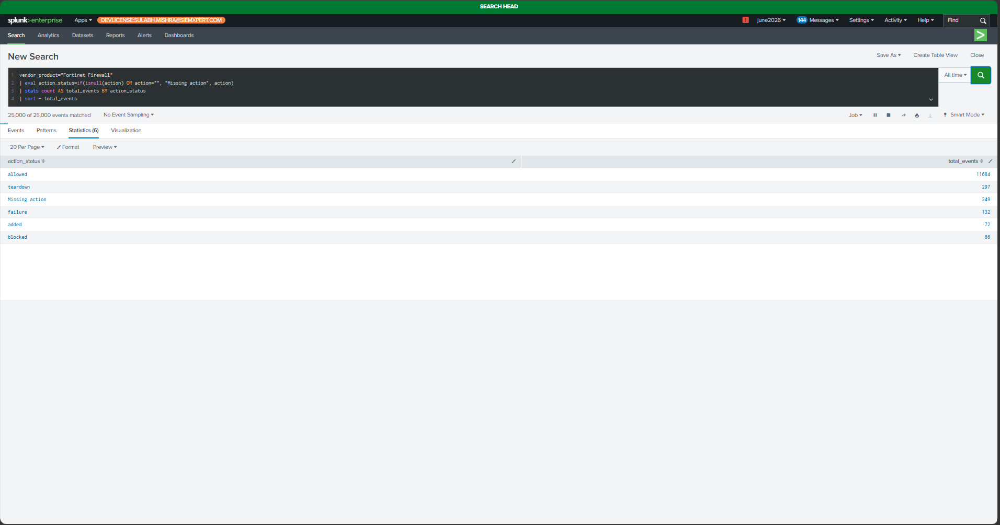
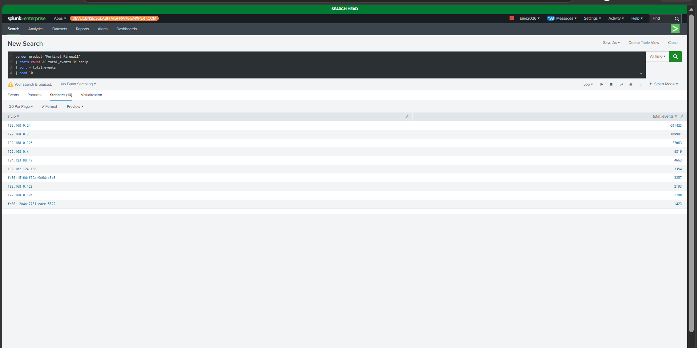
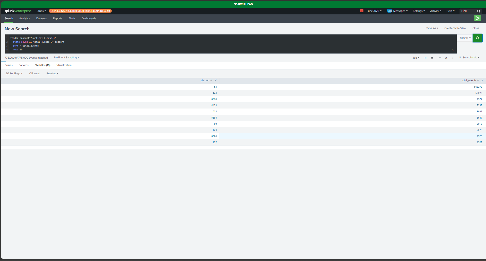
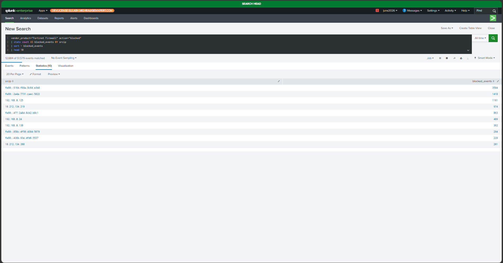
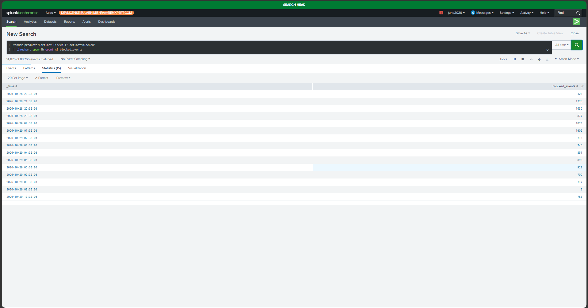
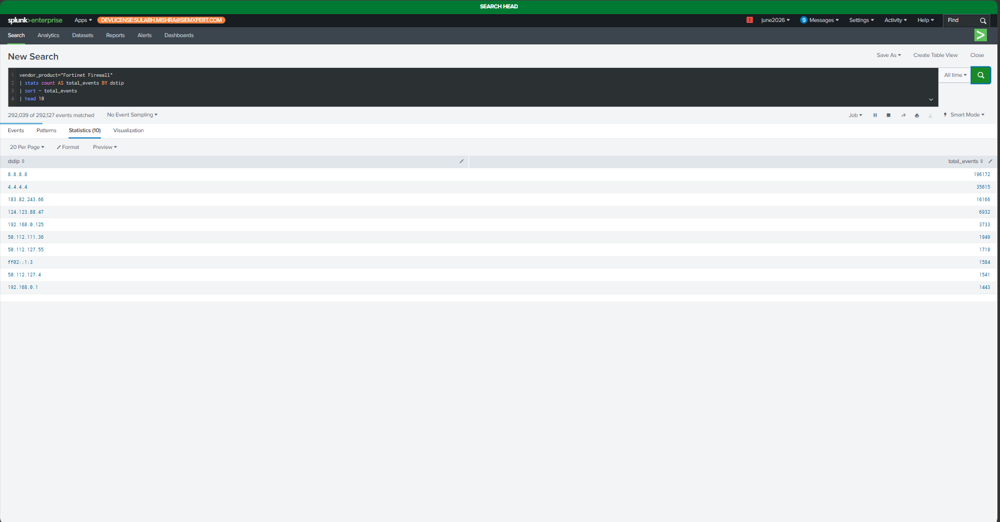
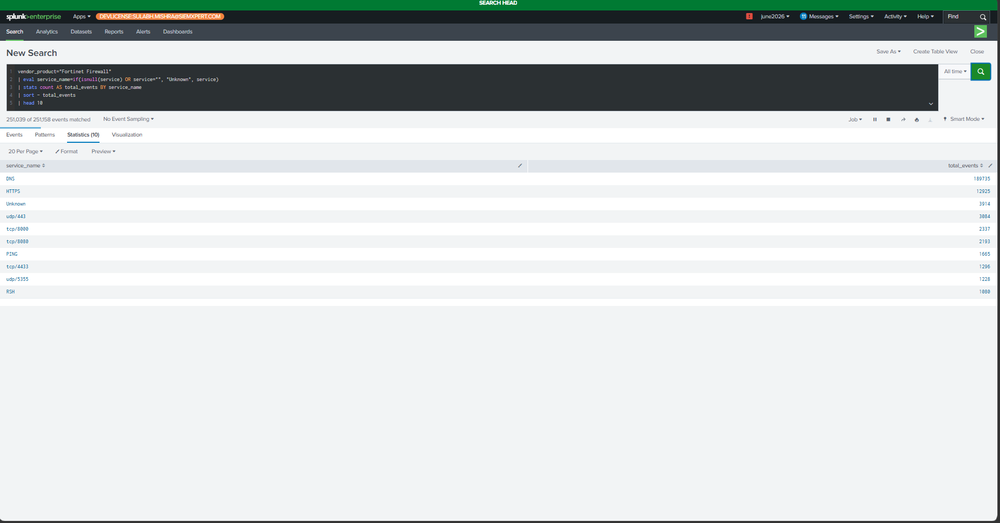

# FortiGate Firewall Log Analysis Using Splunk

## 1. Project Overview

This project focuses on analyzing historical FortiGate firewall logs using Splunk Enterprise. The main objective is to understand network traffic patterns, identify blocked connections, investigate source and destination IP addresses, and monitor destination ports and firewall services.

The project simulates the work of a Security Operations Center (SOC) Analyst by using SIEM searches and dashboards to analyze firewall events.

The firewall logs used in this project were provided by my training institute. The dataset contains historical logs, not live firewall traffic. I do not have direct administrative access to the original FortiGate firewall.

## 2. Project Objectives

- Analyze historical FortiGate firewall logs using Splunk.
- Understand firewall traffic patterns.
- Identify allowed and blocked network connections.
- Identify the most frequently observed source IP addresses.
- Analyze destination IP addresses and destination ports.
- Monitor blocked firewall traffic over time.
- Identify commonly observed firewall services.
- Create a Splunk dashboard for firewall log monitoring.
- Practice basic SOC alert investigation and documentation.
- Develop practical SIEM log analysis skills.

## 3. Lab Architecture

The following diagram represents the workflow used in this project.

```text
+-----------------------------+
| Historical FortiGate Logs   |
| Provided by Training Center |
+--------------+--------------+
               |
               v
+-----------------------------+
| Splunk Enterprise           |
| Log Search and Analysis     |
+--------------+--------------+
               |
               v
+-----------------------------+
| SPL Queries                 |
|                             |
| - Traffic by Action         |
| - Top Source IPs            |
| - Top Destination Ports     |
| - Blocked Source IPs        |
| - Blocked Traffic Over Time |
| - Top Destination IPs       |
| - Traffic by Service        |
+--------------+--------------+
               |
               v
+-----------------------------+
| Splunk Dashboard             |
| Fortinet Firewall dashboard |
+--------------+--------------+
               |
               v
+-----------------------------+
| Investigation and Reporting |
| Findings and Limitations    |
+-----------------------------+
```

## 4. Tools and Technologies Used

| Tool | Purpose |
|---|---|
| Splunk Enterprise | Searching and analyzing firewall logs |
| Search Processing Language (SPL) | Querying and analyzing firewall events |
| FortiGate Firewall Logs | Data source for network traffic analysis |
| Splunk Dashboards | Visualizing firewall traffic patterns |
| GitHub | Documenting and showcasing the project |
| Markdown | Writing project documentation |

## 5. Firewall Log Data

The dataset contains historical firewall logs provided by my training institute.

The following fields are used in the searches, provided they are available and correctly extracted in the dataset.

| Field | Description |
|---|---|
| `vendor_product` | Identifies the firewall vendor or product |
| `action` | Indicates the firewall action recorded in the event |
| `srcip` | Source IP address |
| `dstip` | Destination IP address |
| `dstport` | Destination port |
| `service` | Network service associated with the event |
| `_time` | Timestamp of the event |

**Important:** Field names and action values can vary depending on the log format and field extraction configuration. Confirm the actual field names and values in Splunk before running the searches.

## 6. Splunk SPL Queries and Dashboard Panels

The dashboard is named:

**Fortinet Firewall dashboard**

It contains seven panels for analyzing firewall activity.

### 6.1 Firewall Traffic by Action

**Objective:**

To understand the distribution of firewall events according to the recorded action.

This search groups firewall events by action and counts the number of events for each action. It also identifies events where the action field is missing.

**SPL Query:**

```spl
vendor_product="Fortinet Firewall"
| eval action_status=if(isnull(action) OR action="", "Missing action", action)
| stats count AS total_events BY action_status
| sort - total_events
```

**Explanation:**

- `vendor_product="Fortinet Firewall"` filters the dataset to the specified firewall product.
- `eval` creates an `action_status` field and labels missing actions.
- `stats count` calculates the number of events for each action.
- `sort - total_events` displays the highest event count first.

**Visualization:** Bar chart.

**Screenshot:** `screenshots/01-firewall-traffic-by-action.png`

### 6.2 Top 10 Source IP Addresses

**Objective:**

To identify the source IP addresses that appear most frequently in the firewall logs.

**SPL Query:**

```spl
vendor_product="Fortinet Firewall"
| stats count AS total_events BY srcip
| sort - total_events
| head 10
```

**Explanation:**

- `stats count BY srcip` counts events for each source IP address.
- `sort - total_events` sorts the results from highest to lowest.
- `head 10` displays the first ten results.

**SOC Analyst Use Case:**

This search helps an analyst identify frequently observed sources for further investigation. A high event count alone does not prove that an IP address is malicious.

**Visualization:** Bar chart.

**Screenshot:** `screenshots/02-top-10-source-ips.png`

### 6.3 Top 10 Destination Ports

**Objective:**

To identify the destination ports most frequently observed in the firewall logs.

**SPL Query:**

```spl
vendor_product="Fortinet Firewall"
| stats count AS total_events BY dstport
| sort - total_events
| head 10
```

**Explanation:**

- `stats count BY dstport` counts events for each destination port.
- `sort - total_events` sorts the ports by event count.
- `head 10` displays the ten most frequently observed ports.

**SOC Analyst Use Case:**

Destination port analysis helps an analyst understand which ports are commonly involved in the recorded traffic. Unexpected ports may require additional investigation based on the environment and surrounding events.

**Visualization:** Bar chart.

**Screenshot:** `screenshots/03-top-10-destination-ports.png`

### 6.4 Top 10 Blocked Source IPs

**Objective:**

To identify source IP addresses associated with the highest number of blocked firewall events.

**SPL Query:**

```spl
vendor_product="Fortinet Firewall" action="blocked"
| stats count AS blocked_events BY srcip
| sort - blocked_events
| head 10
```

**Explanation:**

- `action="blocked"` filters the events to those whose action value is `blocked`.
- `stats count BY srcip` counts blocked events for each source IP address.
- `sort - blocked_events` sorts the results from highest to lowest.
- `head 10` displays the top ten source IP addresses.

**SOC Analyst Use Case:**

An analyst can use this search to identify sources associated with repeated blocked connections and investigate their activity.

Repeated blocked events do not automatically indicate an attack. The analyst should review timestamps, destination addresses, ports, firewall policies, and related logs.

**Visualization:** Bar chart.

**Screenshot:** `screenshots/04-top-10-blocked-source-ips.png`

**Note:** If the dataset uses a different value, such as `deny` or `drop`, modify the filter to match the actual values in the `action` field.

### 6.5 Blocked Traffic Over Time

**Objective:**

To observe how blocked firewall events change over time.

**SPL Query:**

```spl
vendor_product="Fortinet Firewall" action="blocked"
| timechart span=1h count AS blocked_events
```

**Explanation:**

- The first line filters the events to blocked traffic.
- `timechart` creates a time-based chart.
- `span=1h` groups the events into one-hour intervals.
- `count` calculates the number of blocked events in each interval.

**SOC Analyst Use Case:**

This visualization helps an analyst identify periods with increases or decreases in blocked traffic. A sudden increase may justify further investigation, but it does not independently confirm malicious activity.

**Visualization:** Line chart.

**Screenshot:** `screenshots/05-blocked-traffic-over-time.png`

**Note:** Because this project uses historical logs, the displayed timeline represents the timestamps in the dataset rather than live firewall activity. Select a time range that includes the available events.

### 6.6 Top 10 Destination IP Addresses

**Objective:**

To identify the destination IP addresses that appear most frequently in the firewall logs.

**SPL Query:**

```spl
vendor_product="Fortinet Firewall"
| stats count AS total_events BY dstip
| sort - total_events
| head 10
```

**Explanation:**

- `stats count BY dstip` counts events for each destination IP address.
- `sort - total_events` sorts the results in descending order.
- `head 10` displays the ten most frequently observed destination IP addresses.

**SOC Analyst Use Case:**

This search helps an analyst understand which destinations appear most frequently in the recorded traffic and determine whether any destinations require further review.

The results should be interpreted using the available network context. A frequently observed destination is not necessarily suspicious.

**Visualization:** Bar chart.

**Screenshot:** `screenshots/06-top-10-destination-ips.png`

### 6.7 Traffic by Firewall Service

**Objective:**

To identify the firewall services most frequently observed in the dataset.

**SPL Query:**

```spl
vendor_product="Fortinet Firewall"
| eval service_name=if(isnull(service) OR service="", "Unknown", service)
| stats count AS total_events BY service_name
| sort - total_events
| head 10
```

**Explanation:**

- `eval` creates a `service_name` field and labels missing service values as `Unknown`.
- `stats count BY service_name` counts events for each service.
- `sort - total_events` sorts the results from highest to lowest.
- `head 10` displays the ten most frequently observed services.

**SOC Analyst Use Case:**

Service analysis helps an analyst understand the services associated with recorded firewall traffic and identify patterns that may require further investigation.

**Visualization:** Bar chart.

**Screenshot:** `screenshots/07-traffic-by-firewall-service.png`

## 7. Dashboard Configuration

**Dashboard Name:** Fortinet Firewall dashboard

The dashboard contains the following seven panels:

| No. | Panel Name | Visualization |
|---|---|---|
| 1 | Firewall Traffic by Action | Bar chart |
| 2 | Top 10 Source IP Addresses | Bar chart |
| 3 | Top 10 Destination Ports | Bar chart |
| 4 | Top 10 Blocked Source IPs | Bar chart |
| 5 | Blocked Traffic Over Time | Line chart |
| 6 | Top 10 Destination IP Addresses | Bar chart |
| 7 | Traffic by Firewall Service | Bar chart |

### Steps to Create the Dashboard

1. Open Splunk Enterprise.
2. Navigate to the Search & Reporting application.
3. Enter the SPL query for the first panel.
4. Select the appropriate time range for the historical dataset.
5. Run the search and check the results.
6. Select the Visualization tab.
7. Choose the recommended chart type.
8. Save the visualization to a new dashboard or add it to an existing dashboard.
9. Name the dashboard `Fortinet Firewall dashboard`.
10. Repeat the process for the remaining six queries.
11. Open the dashboard and verify that the panels display the expected results.
12. Capture screenshots for the GitHub repository.

**Important:** The dashboard name and screenshot filenames in this README are documentation conventions. Save your panels using these names or update the README to match your actual Splunk configuration.

## 8. Screenshots

Add your actual screenshots from Splunk in the `screenshots` folder.

### 8.1 Firewall Traffic by Action



### 8.2 Top 10 Source IP Addresses



### 8.3 Top 10 Destination Ports



### 8.4 Top 10 Blocked Source IPs



### 8.5 Blocked Traffic Over Time



### 8.6 Top 10 Destination IP Addresses



### 8.7 Traffic by Firewall Service



**Note:** These image references will display screenshots only after you upload the corresponding image files to your GitHub repository. They are not actual screenshots by themselves.

## 9. Investigation Workflow

The following workflow describes how a SOC analyst can approach firewall log analysis.

### Step 1: Review Overall Firewall Activity

Start by reviewing the total event distribution by action.

Identify which action values appear in the dataset and check whether any events have missing action values.

### Step 2: Review Source IP Addresses

Examine the most frequently observed source IP addresses.

Check whether their activity is expected and whether the same sources appear in blocked traffic or other relevant events.

### Step 3: Analyze Destination Ports

Review the destination ports associated with the highest event counts.

Determine whether the observed ports are consistent with expected network services.

### Step 4: Investigate Blocked Connections

Review the sources associated with blocked events.

Investigate repeated activity by checking the destination IP, destination port, timestamps, and related records where available.

### Step 5: Review Blocked Traffic Over Time

Look for periods when blocked traffic increases or decreases.

Compare the observed pattern with other available events before deciding whether further investigation is required.

### Step 6: Analyze Destination IP Addresses and Services

Review frequently observed destinations and firewall services.

Use the results to understand the recorded network traffic and identify activity that may need additional context.

### Step 7: Document the Findings

Record the following details in an investigation report:

- Investigation objective
- Data source
- Search time range
- SPL queries used
- Important observations
- Relevant source and destination IP addresses
- Destination ports and services
- Supporting screenshots
- Investigation limitations
- Recommended follow-up actions

## 10. Sample Investigation Report

Use this structure to document the findings from your actual Splunk searches.

### Investigation Title

FortiGate Firewall Log Analysis

### Objective

To analyze historical FortiGate firewall logs using Splunk and identify traffic patterns, blocked connections, frequently observed source IP addresses, destination ports, destination IP addresses, and firewall services.

### Data Source

Historical FortiGate firewall logs provided by the training institute.

### Analysis Tool

Splunk Enterprise.

### Investigation Findings

**1. Firewall Traffic by Action**

Record the action values present in the dataset and the event counts for each action.

**2. Top Source IP Addresses**

Record the source IP addresses with the highest event counts and describe any relevant observations.

**3. Top Destination Ports**

Record the most frequently observed destination ports and identify any ports that require further review.

**4. Blocked Source IP Addresses**

Record the sources associated with the highest number of blocked events.

**5. Blocked Traffic Over Time**

Describe any noticeable increases or decreases in blocked events during the available time period.

**6. Top Destination IP Addresses**

Record the most frequently observed destination IP addresses.

**7. Traffic by Firewall Service**

Record the services with the highest event counts.

### Conclusion

The project demonstrates how Splunk can be used to search and visualize historical FortiGate firewall logs. The dashboard provides an overview of firewall activity and supports the initial investigation of blocked connections, source IP addresses, destination ports, destination IP addresses, and services.

Final conclusions must be based on the actual search results. High event counts and blocked connections alone are insufficient to confirm malicious activity.

### Recommended Follow-Up

Where sufficient data is available, investigate relevant events using additional context, such as timestamps, firewall policies, related logs, and information about the affected network.

**Important:** Complete this report using your actual results. Do not report specific suspicious IP addresses, event counts, attacks, or incidents unless your evidence supports those conclusions.

## 11. How to Reproduce the Project

1. Open Splunk Enterprise.
2. Confirm that the historical FortiGate logs are available in Splunk.
3. Check the source type and relevant field extractions.
4. Run a basic search to verify that the expected events are returned.
5. Confirm the actual values of the `action` field.
6. Run each SPL query in Section 6.
7. Choose the appropriate time range for the historical events.
8. Verify that each search returns meaningful results.
9. Create the seven dashboard panels.
10. Save the dashboard as `Fortinet Firewall dashboard`.
11. Capture screenshots of the completed panels.
12. Save the SPL queries as separate `.spl` files.
13. Add the screenshots and documentation to GitHub.
14. Update the investigation report with actual observations.

## 12. Limitations

- The project uses historical logs rather than live firewall traffic.
- The original firewall is not directly accessible to me.
- The analysis is limited to the events and fields available in the provided dataset.
- The results depend on the selected Splunk time range.
- Field names and action values may differ between log formats.
- The project does not independently prove that an attack occurred.
- The dashboard provides visibility into recorded events but does not automatically establish malicious intent.
- No claim of automated blocking, remediation, or live incident response is made.

## 13. Security and Data Handling

- Use only logs you are authorized to access.
- Do not publish confidential firewall logs or sensitive organizational information.
- Mask internal IP addresses and other sensitive values when required.
- Review screenshots before uploading them to a public repository.
- Do not publish credentials, tokens, private keys, or other secrets.
- Follow your training institute's data-sharing policies.

## 14. Skills Demonstrated

- Splunk Enterprise
- Search Processing Language (SPL)
- Firewall log analysis
- FortiGate log analysis
- SIEM fundamentals
- Network traffic analysis
- Source and destination IP analysis
- Destination port analysis
- Blocked traffic investigation
- Time-based event analysis
- Dashboard creation
- Basic SOC investigation workflow
- Investigation documentation
- GitHub project documentation

## 15. Repository Structure

Organize the GitHub repository as follows:

```text
FortiGate-Firewall-Log-Analysis/
│
├── README.md
│
├── screenshots/
│   ├── 01-firewall-traffic-by-action.png
│   ├── 02-top-10-source-ips.png
│   ├── 03-top-10-destination-ports.png
│   ├── 04-top-10-blocked-source-ips.png
│   ├── 05-blocked-traffic-over-time.png
│   ├── 06-top-10-destination-ips.png
│   └── 07-traffic-by-firewall-service.png
│
├── spl-queries/
│   ├── 01-traffic-by-action.spl
│   ├── 02-top-source-ips.spl
│   ├── 03-top-destination-ports.spl
│   ├── 04-blocked-source-ips.spl
│   ├── 05-blocked-traffic-over-time.spl
│   ├── 06-top-destination-ips.spl
│   └── 07-traffic-by-service.spl
```

## 16. Future Improvements

Possible improvements include:

- Add additional firewall log fields to the analysis.
- Create filters for source IP, destination IP, and action.
- Investigate unusual traffic patterns using relevant contextual evidence.
- Correlate firewall events with Windows security logs when authorized data is available.
- Develop additional searches for specific investigation scenarios.
- Add more detailed investigation reports with evidence and conclusions.
- Explore alerting features using an appropriate test dataset and validated detection logic.

These are possible future enhancements and should not be described as completed features unless they have actually been implemented.

## 17. Disclaimer

This project is intended for educational purposes and SOC Analyst practice. It demonstrates the use of Splunk to analyze historical firewall logs.

The findings depend on the supplied dataset and the searches performed. The project does not claim that any particular attack occurred, and it does not represent live monitoring of the original firewall.

## 18. Author

**Project:** FortiGate Firewall Log Analysis Using Splunk

**Focus:** SIEM, Firewall Log Analysis, and SOC Analyst Skills

**Platform:** GitHub
